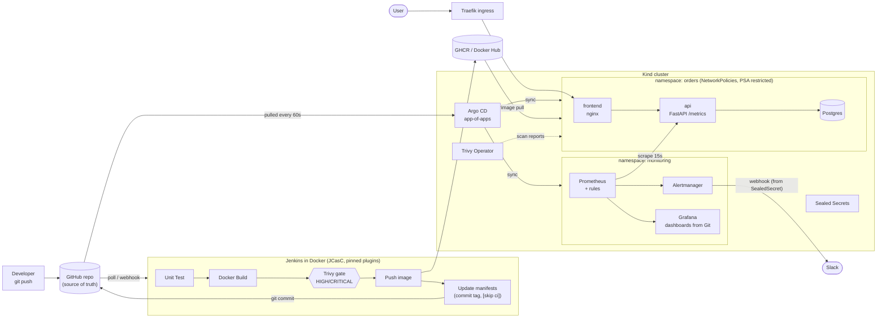

# Secure, Observable GitOps Platform

A production-style delivery platform for a small three-tier app, built to demonstrate three things with evidence:
**CI security scanning**, **GitOps delivery**, and **observability with alerting**. Everything runs on a laptop (Kind).

| Capability | How it is proven |
|---|---|
| CI security | Jenkins pipeline fails on fixable HIGH/CRITICAL CVEs (Trivy); reports + SBOMs archived on every build |
| GitOps CD | Argo CD app-of-apps, auto-sync + self-heal; **Jenkins has no cluster access**, it only commits an image tag to Git |
| Observability | Prometheus/Grafana via Helm, RED + SLO dashboards provisioned from JSON in Git, SLO burn-rate alerts to Slack |
| Secrets | No plaintext secrets in Git: JCasC env vars for CI, Sealed Secrets for the Slack webhook |
| Resilience | Incident drill: error injection + container crashes + pod kill, with timeline and screenshots |

## Architecture



**Delivery flow:** `git push` -> Jenkins tests, builds, scans, pushes the image, then edits **one file** in Git
(`k8s/overlays/staging/kustomization.yaml`). Argo CD notices the change and rolls it out. Rollback is `git revert`.

## Quick start

Full step-by-step guide (prerequisites, tokens, what to expect at each step, troubleshooting):
**[docs/EXECUTION_GUIDE.md](docs/EXECUTION_GUIDE.md)**. The short version:

```bash
make verify-pins                  # 0. confirm all pinned versions exist
make cluster-up                   # 1. Kind (3 nodes) + Traefik
make jenkins-up                   # 2. Jenkins; fill tokens in ci/.env, run again; make jenkins-lock; run the first build
make argocd-up                    # 3. Argo CD
make argocd-bootstrap             # 4. root app: Argo CD deploys the app, monitoring, scanners
make seal-secrets                 # 5. encrypt the Slack webhook, commit, push
make urls                         # 6. open Grafana, Argo CD, Prometheus, Alertmanager
make test && make netpol-test     # 7. verify
make drill                        # 8. incident drill (screenshots)
```

## Run it on AWS (ap-south-1)

Step-by-step guide with two paths, Terraform included: **[docs/AWS_DEPLOYMENT_GUIDE.md](docs/AWS_DEPLOYMENT_GUIDE.md)**.

```bash
make aws-ec2-up      # Path A: EC2 host via Terraform (single-IP SSH, IMDSv2, encrypted disk, budget alert)
make eks-up MY_IP=$(curl -s https://checkip.amazonaws.com)    # Path B: Amazon EKS + gp3 + NLB limited to your IP
```

## Preview

Screens of the running platform: **[docs/PREVIEW.md](docs/PREVIEW.md)**.

## Tool choices and why

| Choice | Why (and the trade-off) |
|---|---|
| **Kind** | Real multi-node Kubernetes in Docker; free, fast, reproducible. Not a cloud cluster, so no cloud LB/IAM. |
| **Kustomize (base + overlays)** | Plain YAML, no templating; the CI can safely change one `newTag` with `kustomize edit set image`. |
| **Jenkins + JCasC** | Widely used in industry; JCasC makes the controller reproducible and secret-free. Builds run on the controller here to keep it small (production: ephemeral agents). |
| **Docker-in-Docker sidecar** | Jenkins never receives the host Docker socket (root-equivalent). Isolated, throwaway daemon. |
| **Trivy (CI gate + Operator)** | One scanner at build time (gate, SBOM) and in-cluster (drift: new CVEs in running images). `--ignore-unfixed` keeps the gate actionable. |
| **Argo CD (app-of-apps)** | Declarative, pull-based CD with UI, drift detection, self-heal. App-of-apps makes every add-on a file in Git. |
| **Traefik** | Maintained ingress controller (ingress-nginx is retired upstream). |
| **kube-prometheus-stack** | Standard Prometheus Operator stack: CRDs (ServiceMonitor, PrometheusRule), Alertmanager, Grafana in one chart. |
| **Dashboards as ConfigMaps from JSON** | Reviewable, versioned, no click-ops; the Grafana sidecar loads them. |
| **SLO burn-rate alert** | Pages on user impact (budget burn) rather than only raw thresholds. |
| **Sealed Secrets** | Encrypted secrets can live in Git and be synced by Argo CD; only the cluster can decrypt. |
| **k6 in Docker** | Thresholds-as-code mirror the SLO/alerts; nothing to install. |

## Security model

- No secrets in Git (`make validate` scans for them): CI credentials come from `ci/.env` through JCasC; the DB password and Grafana
  password are generated at bootstrap; the Slack webhook is a SealedSecret.
- Non-root containers, read-only root filesystems, dropped capabilities, seccomp, Pod Security `restricted` on the app namespace.
- Default-deny NetworkPolicies with explicit allow rules (`make netpol-test` proves enforcement).
- Jenkins image has no kubectl/helm and no kubeconfig (`make verify-gitops` proves the boundary).
- All images, charts, Jenkins core and tools are pinned; Jenkins plugins are pinned by a lock file (`make jenkins-lock`).

## Repository layout

```
app/api          FastAPI service: /health /ready /metrics /orders /fail?rate=N (+ gated /chaos/crash)
app/frontend     Static UI on unprivileged nginx
k8s/base         Postgres, API, frontend, Ingress, PDB, NetworkPolicies
k8s/overlays     dev (local images), staging (GHCR images, edited by Jenkins)
kind/            Cluster + Traefik config
ci/              Jenkinsfile, Dockerfile, docker-compose.yml, jenkins.yaml (JCasC), plugins.txt
argocd/          install/, bootstrap/ (root app), apps/ (children), optional/
monitoring/      Helm values, ServiceMonitor, PrometheusRules, dashboards (JSON), Jenkins add-on
load-test/       k6 script (smoke, steady, load, incident)
scripts/         bootstrap, seal, drill, validation, packaging
docs/            EXECUTION_GUIDE, gitops, ci, runbook, incident-drill, images/, evidence/
```

## Incident: problem -> alert -> fix

> Run `make drill`, then replace the placeholders below with your screenshots (`docs/images/`, names in
> [docs/incident-drill.md](docs/incident-drill.md)) and paste the numbers from `make drill-summary`.

**Problem.** Errors and latency are injected through the API's fault endpoint while two API containers are
crashed and one pod is killed, simulating a bad release plus node trouble.


*01: healthy baseline, SLO above 99%.*


*03: restarts and CrashLoopBackOff, while the second replica keeps serving (PodDisruptionBudget).*

**Alert.** `OrdersHighErrorRate` (>5% for 5m), `OrdersPodCrashLooping`, `OrdersHighLatencyP95` (>300ms) and
`OrdersLatencySLOFastBurn` fire; Alertmanager posts to Slack with a runbook link.


*04: error rate spike, p95 over the 300ms line, SLO panel red.*


*05: alerts FIRING in Prometheus.*


*07: Slack notification (webhook stored as a Sealed Secret).*

**Fix.** Stop the fault; Kubernetes already replaced the pods and Argo CD kept the desired state (no manual
`kubectl edit`; self-heal would revert it anyway). For a bad *release* the fix is `git revert` of the release commit.


*09: recovered.*


*10: RESOLVED notification.*

| Metric | Result (from `make drill-summary`) |
|---|---|
| Time to detect (error-rate alert firing) | `__ s` |
| Time to detect (crash-loop alert firing) | `__ s` |
| Time to recover (fault removed to resolved) | `__ s` |
| User-facing downtime | none expected (2 replicas + PDB): verify with k6 logs |

Alert response procedures: [docs/runbook.md](docs/runbook.md).

## Honest limitations

- Single-node-class laptop cluster; Prometheus has no persistent volume; one Postgres instance (no HA/backups).
- Jenkins builds on the controller; production would use ephemeral agents.
- The DB password is created at bootstrap (not in Git) rather than sealed, to avoid a chicken-and-egg on first sync.
- The `/chaos/crash` endpoint exists for the drill, is off by default, and is blocked at the ingress.

See also: [docs/gitops.md](docs/gitops.md), [docs/ci.md](docs/ci.md), [RESUME.md](RESUME.md).
