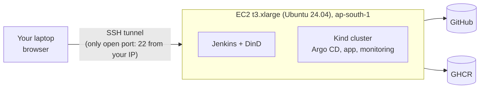
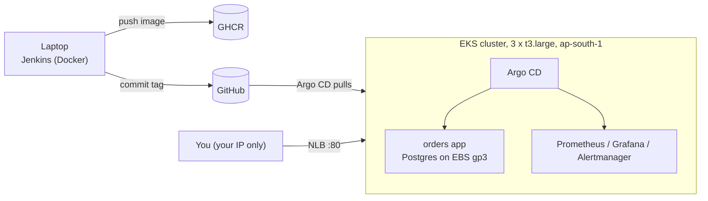

# Deploy on AWS (region `ap-south-1`, Mumbai)

Two ways to run this project on AWS. Pick one.

| | **Path A: EC2 + Kind** (recommended) | **Path B: Amazon EKS** |
|---|---|---|
| What runs | One EC2 VM runs the same Kind cluster, Jenkins and everything else | A managed Kubernetes cluster (3 worker nodes) on AWS |
| Setup time | about 30 min | about 60 min (cluster creation takes 15-20 min) |
| Approx. cost* | about US$0.18/hour while running | about US$0.40-0.60/hour (control plane + 3 nodes + load balancer) |
| Fidelity | Identical to the local guide, nothing to adapt | "Real" cloud Kubernetes: EBS volumes, AWS load balancer, IAM roles |
| Best for | Getting the project running and capturing screenshots | Showing AWS/EKS experience on your resume |
| Jenkins runs on | The same EC2 VM | Your laptop (or any Docker host) |

\*Rough on-demand estimates for `ap-south-1`. Always check the AWS pricing pages and set a budget alert (Step A3 does this).
**Both cost real money while running. Run the teardown steps when you finish.**

> You can do Path A first (to get everything working), then Path B later. Path B does not need Path A.

---

## Step 0: One-time AWS setup (both paths)

1. **AWS account.** Use a personal/sandbox account. Turn on **MFA** for the root user and do not use root for daily work.
2. **IAM user or SSO role** for yourself with permissions to create EC2, IAM roles, budgets (Path A) and EKS/CloudFormation/VPC (Path B).
   For a personal sandbox account, `AdministratorAccess` on a named IAM user with MFA is the simplest.
3. **Install on your laptop:** AWS CLI v2, plus Terraform >= 1.6 (Path A) or eksctl + kubectl + helm (Path B), and git.
4. **Configure the CLI** with the Mumbai region:
   ```bash
   aws configure          # Access key, secret, region: ap-south-1, output: json
   aws sts get-caller-identity
   ```
   **Check:** the output shows your account ID and user ARN. If it errors, fix credentials before going on.
5. **Put the code on GitHub** (Jenkins and Argo CD read from it). Create an empty repo
   `ADITYASURVE123/secure-observable-gitops-platform`, then from the unzipped project:
   ```bash
   git remote add origin https://github.com/ADITYASURVE123/secure-observable-gitops-platform.git
   git push -u origin main
   ```
6. **Create the two tokens** (GHCR `write:packages` token, and a Git token with Contents read/write on that repo).
   Details: `docs/EXECUTION_GUIDE.md`, step 3. Keep them out of chat and out of Git.

---

# Path A: EC2 + Kind



### A1. Create an SSH key (laptop)
```bash
ssh-keygen -t ed25519 -f ~/.ssh/gitops-aws -C gitops-aws
```

### A2. Find your public IP (laptop)
```bash
curl -s https://checkip.amazonaws.com        # e.g. 203.0.113.10
```

### A3. Configure Terraform (laptop)
```bash
cd secure-observable-gitops-platform/aws/ec2/terraform
cp terraform.tfvars.example terraform.tfvars
nano terraform.tfvars
```
Set:
- `allowed_ssh_cidr` = your IP followed by `/32` (for example `"203.0.113.10/32"`)
- `ssh_public_key` = the output of `cat ~/.ssh/gitops-aws.pub`
- `budget_email` = your email (recommended: you get an alert at 80% of a US$50 monthly budget)

`terraform.tfvars` is git-ignored. Terraform refuses `0.0.0.0/0` on purpose.

### A4. Create the server (laptop)
```bash
cd ../../..                                   # back to the project root
make aws-ec2-up                               # runs terraform init + apply; type "yes" when asked
make aws-ec2-output                           # prints ssh_command, tunnel_command, stop_command, ...
```
**Check:** the output shows `instance_id`, `public_ip` and a ready-to-copy `ssh_command`.

### A5. Log in and wait for the first-boot install (about 3-5 min)
```bash
ssh -i ~/.ssh/gitops-aws ubuntu@<public_ip>            # copy from the output
cloud-init status --wait                               # waits, then prints: status: done
ls /var/lib/gitops-bootstrap-done                      # file exists = tools installed
exit                                                   # log out and back in so the docker group applies
ssh -i ~/.ssh/gitops-aws ubuntu@<public_ip>
docker --version && kind version && kubectl version --client && helm version --short && kubeseal --version
```
**Check:** all five commands print a version. If not, read `/var/log/gitops-bootstrap.log`.

No SSH? Use Session Manager instead: `aws ssm start-session --target <instance_id> --region ap-south-1`.

### A6. Get the code onto the server (on EC2)
```bash
git clone https://github.com/ADITYASURVE123/secure-observable-gitops-platform.git
cd secure-observable-gitops-platform
git config user.name "ADITYASURVE123"
git config user.email "ADITYASURVE123@users.noreply.github.com"
```
(For a private repo, clone with `https://ADITYASURVE123:<token>@github.com/...` once, then remove the token from the remote with
`git remote set-url origin https://github.com/ADITYASURVE123/secure-observable-gitops-platform.git`.)

### A7. Open the tunnel (a second terminal on your laptop; leave it running)
```bash
ssh -i ~/.ssh/gitops-aws -N -L 8080:localhost:8080 -L 8081:localhost:8081 ubuntu@<public_ip>
```
Now, **in your laptop browser**, these work as soon as the services exist:

| What | URL |
|---|---|
| App | http://localhost:8080 |
| Jenkins | http://localhost:8081 |
| Argo CD | http://argocd.localhost:8080 |
| Grafana | http://grafana.localhost:8080 |
| Prometheus | http://prometheus.localhost:8080 |
| Alertmanager | http://alertmanager.localhost:8080 |

(`*.localhost` resolves to your own machine; the tunnel carries it to the server, where Traefik routes by hostname.)

### A8. Run the platform (on EC2: your first terminal)
Run these in order. After each, do the **Check** listed in `docs/EXECUTION_GUIDE.md` (same step numbers).

```bash
make verify-pins                  # Guide step 2
make cluster-up                   # step 4:  kubectl get nodes -> 3 Ready
make jenkins-up                   # step 6:  first run creates ci/.env, then stops
nano ci/.env                      #          paste REGISTRY_TOKEN and GIT_TOKEN (typed on the server, never committed)
make jenkins-up                   #          builds and starts Jenkins
make jenkins-lock                 #          pins plugins
git add ci/plugins.lock.txt && git commit -m "build(ci): pin Jenkins plugins" && git push
```
In your **laptop browser** open http://localhost:8081 (user `admin`, password = `JENKINS_ADMIN_PASSWORD` in `ci/.env`;
`grep JENKINS_ADMIN ci/.env` on the server) and click **Build Now** on `orders-platform`. When it is green:
```bash
git pull --rebase                 # fetch Jenkins' release commit
```
Make the two GHCR packages **public** (GitHub > Packages > each package > Package settings), then:
```bash
make argocd-up                    # step 7
make argocd-password              #          copy it; log in at http://argocd.localhost:8080 as admin
make argocd-bootstrap             # step 8:  wait 5-10 min
make gitops-status                #          all Synced / Healthy
make smoke && make verify-gitops && make netpol-test
make seal-secrets                 # step 9 (optional Slack)
git add monitoring && git commit -m "feat(monitoring): add sealed Slack webhook" && git push
make urls
make load-test PROFILE=load       # step 10
make drill                        # step 11: guided incident drill, take screenshots in your laptop browser
```
Take screenshots on your **laptop** (through the tunnel) and save them into `docs/images/` with the names in
`docs/incident-drill.md`, then commit them. (`scp -i ~/.ssh/gitops-aws *.png ubuntu@<ip>:~/secure-observable-gitops-platform/docs/images/`
or commit from your laptop clone and `git pull` on the server.)

### A9. Save money between sessions
```bash
aws ec2 stop-instances  --instance-ids <instance_id> --region ap-south-1     # compute charges stop; disk remains (small cost)
aws ec2 start-instances --instance-ids <instance_id> --region ap-south-1     # later; the public IP changes
```
After a restart, Docker restarts Kind automatically; if pods look stuck run `docker ps` then `make status`.
The public IP changes on each start: use the new one in SSH and the tunnel (`make aws-ec2-output`).

### A10. Tear down (stops ALL charges)
```bash
make jenkins-down                 # on the server (optional)
make aws-ec2-down                 # on the laptop: type "yes"
```
**Check:** `aws ec2 describe-instances --region ap-south-1 --filters Name=tag:Project,Values=gitops-platform --query 'Reservations[].Instances[].State.Name'`
shows `terminated`. Also delete the GHCR packages and **revoke the two tokens** if you will not use them again.

---

# Path B: Amazon EKS



### B1. Tools (laptop)
Install `eksctl`, `kubectl`, `helm`, `kubeseal`, Docker, AWS CLI v2 (Step 0 done). Check:
```bash
eksctl version && kubectl version --client && helm version --short
```

### B2. Pick a supported Kubernetes version
```bash
aws eks describe-cluster-versions --region ap-south-1 \
  --query 'clusterVersions[?status==`STANDARD_SUPPORT`].clusterVersion' --output text
```
If `1.34` (in `aws/eks/cluster.yaml`) is not in the list, edit `version:` to one that is.
Also run `make verify-pins`.

### B3. Create the cluster (15-20 min)
```bash
make eks-up MY_IP=$(curl -s https://checkip.amazonaws.com)
```
This creates the EKS cluster, 3 managed nodes, the EBS CSI driver, VPC CNI with NetworkPolicy enforcement, a gp3 default
StorageClass, and Traefik behind an AWS Network Load Balancer **that only accepts traffic from your IP**.

**Check:**
```bash
kubectl get nodes                                        # 3 Ready
kubectl -n traefik get svc traefik                       # EXTERNAL-IP shows an *.elb.ap-south-1.amazonaws.com name
export LB=$(kubectl -n traefik get svc traefik -o jsonpath='{.status.loadBalancer.ingress[0].hostname}')
echo $LB
```

### B4. Jenkins on your laptop (first build)
Same as the local guide, step 6: `make jenkins-up`, edit `ci/.env`, `make jenkins-up`, `make jenkins-lock`, commit and push, open
http://localhost:8081, **Build Now**, `git pull --rebase`, make the GHCR packages **public**.
(EKS nodes pull the images over the internet from GHCR; no AWS registry setup is needed.)

### B5. Argo CD and bootstrap
```bash
make argocd-up
make argocd-bootstrap
make gitops-status                  # all Synced / Healthy after 5-10 min
```

### B6. Open the UIs (port-forward; `*.localhost` host names do not exist on AWS)
Run each in its own terminal:
```bash
kubectl -n argocd     port-forward svc/argocd-server                          8082:80     # http://localhost:8082
kubectl -n monitoring port-forward svc/kube-prometheus-stack-grafana          3000:80     # http://localhost:3000
kubectl -n monitoring port-forward svc/kube-prometheus-stack-prometheus       9090:9090   # http://localhost:9090
kubectl -n monitoring port-forward svc/kube-prometheus-stack-alertmanager     9093:9093   # http://localhost:9093
```
Passwords: `make argocd-password`, `make grafana-password`. The app itself: `http://$LB`.

### B7. Verify, load-test and run the drill against AWS
Point the scripts at the load balancer (it only accepts your IP):
```bash
export BASE_URL=http://$LB
make smoke
make netpol-test                    # VPC CNI enforces NetworkPolicy (enabled in cluster.yaml)
make load-test PROFILE=load
make seal-secrets                   # then commit + push (optional Slack)
make drill                          # works unchanged; screenshots use the port-forwarded UIs
```
If your IP changes (new network), update the allow-list:
`kubectl -n traefik patch svc traefik -p '{"spec":{"loadBalancerSourceRanges":["NEW.IP/32"]}}'`

### B8. Tear down (IMPORTANT: this is where costs hide)
```bash
make eks-down
```
It deletes the Argo CD apps, all PersistentVolumeClaims (EBS volumes), Traefik (the load balancer), then the cluster.
**Check there is nothing left:**
```bash
aws eks list-clusters --region ap-south-1
aws elbv2 describe-load-balancers --region ap-south-1 --query 'LoadBalancers[].LoadBalancerName'
aws ec2 describe-volumes --region ap-south-1 --filters Name=status,Values=available --query 'Volumes[].VolumeId'
```
All three should be empty (volumes that are not yours may exist; delete only ones tagged for this project).

---

## AWS security checklist
- No inbound ports are open to the internet: SSH only from your `/32` (Path A) or the load balancer only from your `/32` (Path B).
- IMDSv2 enforced; containers cannot reach instance metadata (hop limit 1). Disks are encrypted.
- Shell access without SSH is possible with SSM Session Manager (IAM-authenticated).
- Tokens live only in `ci/.env` on the host (git-ignored). Revoke them and destroy the stack when done.
- A budget alert is created if you set `budget_email`.
- Do not use the root account; enable MFA.

## AWS troubleshooting

| Symptom | Fix |
|---|---|
| `terraform apply`: `UnauthorizedOperation` | Your IAM user lacks EC2/IAM permissions; use an admin user in your sandbox account |
| `terraform apply`: invalid `allowed_ssh_cidr` | Use `x.x.x.x/32`; `0.0.0.0/0` is refused |
| SSH times out | Your IP changed: edit `allowed_ssh_cidr`, run `make aws-ec2-up` again |
| `Instance type not supported` in the AZ | Set `instance_type = "m6i.xlarge"` in `terraform.tfvars` |
| Pods `Pending` / OOM on EC2 | Too small; use at least 4 vCPU / 16 GB (`t3.xlarge`) |
| Kind fails: "too many open files" | `sudo sysctl --system` (user_data sets it); then `make teardown && make cluster-up` |
| EKS: Postgres PVC `Pending` | EBS CSI addon not ready: `kubectl -n kube-system get pods | grep ebs`; check `kubectl get sc` shows `gp3 (default)` |
| EKS: app not reachable at `$LB` | NLB takes 2-3 min to register; confirm your IP is allowed; `kubectl -n traefik get svc traefik` |
| EKS: NetworkPolicy test says NOT enforced | `aws eks describe-addon --cluster-name gitops-platform --addon-name vpc-cni --region ap-south-1` must show `enableNetworkPolicy: "true"` |
| `eksctl create cluster` fails on quota | Request vCPU quota increase for On-Demand Standard instances in `ap-south-1` |

## What you can honestly say on your resume (only after you did it)
- Path A: "Provisioned the platform's host on AWS with Terraform (EC2, IAM/SSM, security groups, budget alert), locked down to a single-IP SSH tunnel with IMDSv2 and encrypted storage."
- Path B: "Deployed the GitOps platform to Amazon EKS (eksctl, EBS CSI, VPC CNI network policies, NLB restricted by source range) in ap-south-1."
