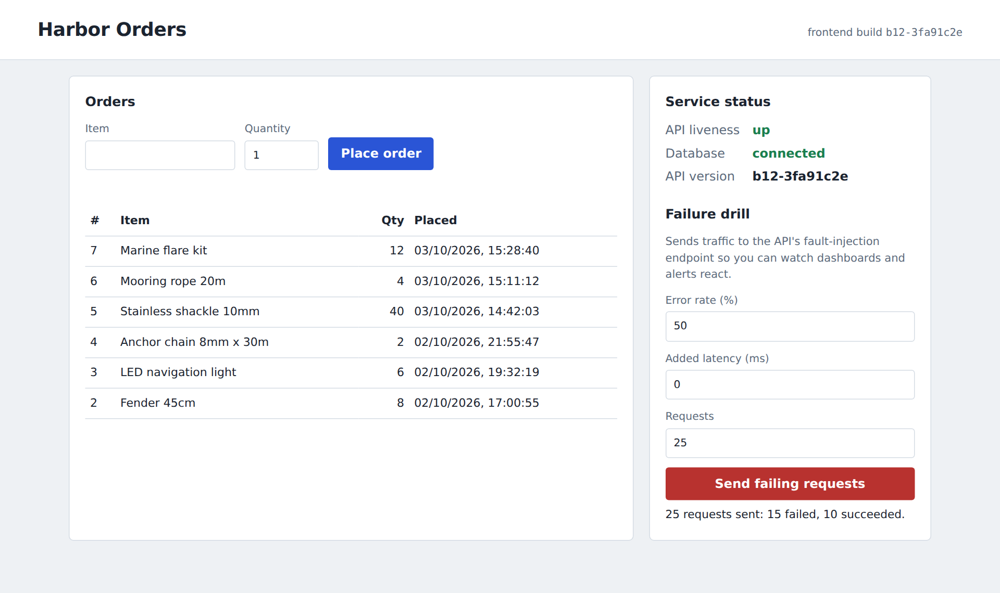
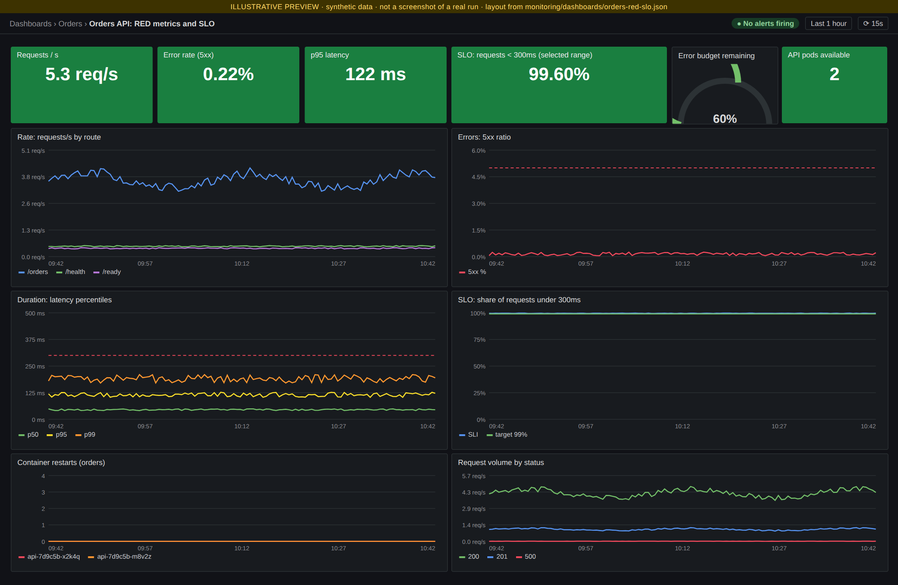
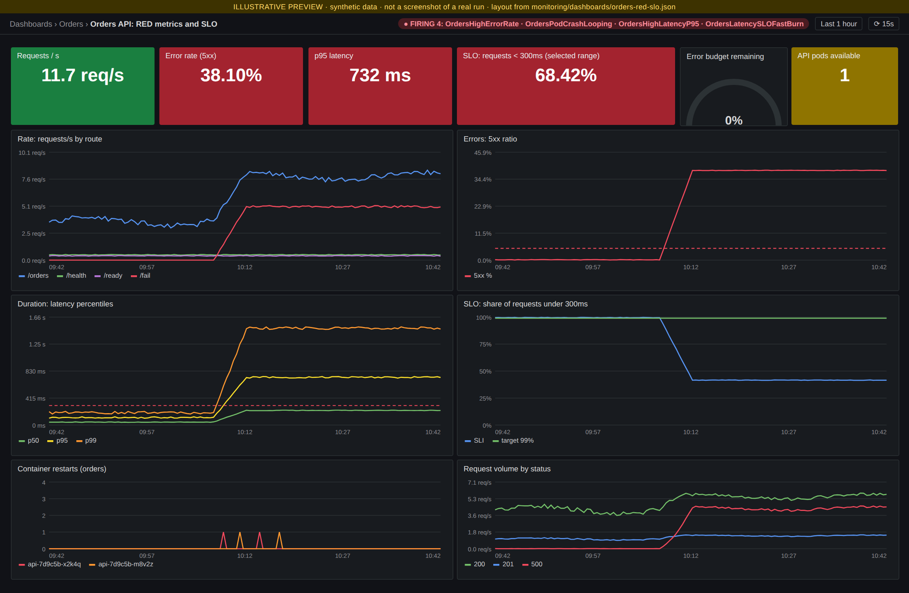
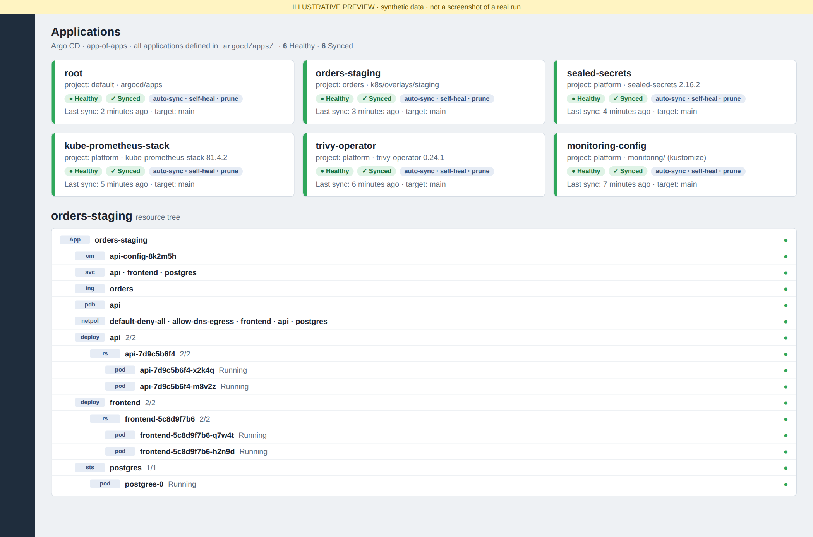
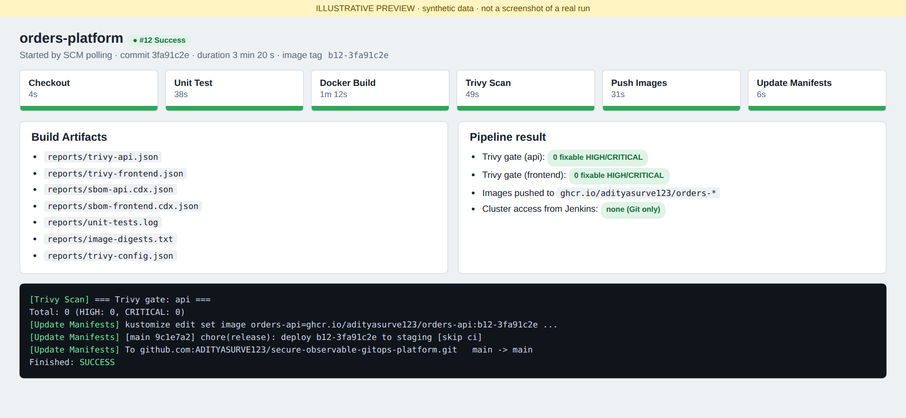
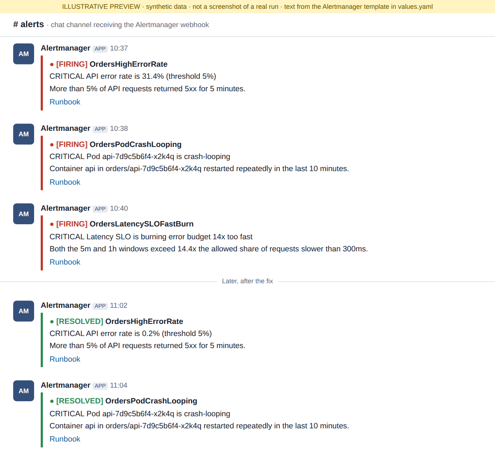

# Preview: what the project looks like

> **Honesty note.** Image 01 is a **real render of the actual frontend code** (the project's own HTML/CSS/JS, with the API mocked).
> Images 02-06 are **illustrative**: layouts, titles, thresholds and text come from the files in this repo
> (`monitoring/dashboards/orders-red-slo.json`, `argocd/apps/`, `ci/Jenkinsfile`, the Alertmanager template), but the plotted
> data is synthetic and the Argo CD / Jenkins / chat screens are mock-ups. They are **not evidence of a run**.
> After you run the project, replace them with your own screenshots (`docs/incident-drill.md`).
> Regenerate these previews with `python3 scripts/render-preview.py` (needs `pip install playwright && playwright install chromium`).

## 1. The app (real render): "Harbor Orders"
Orders list and form, live service status (API liveness, database, version), and the failure-drill panel that sends
traffic to `/api/fail` so you can watch dashboards and alerts react.

## 2. Grafana: healthy
RED metrics (rate, errors, duration), the **99% of requests under 300ms** SLO with error budget, pod availability and restarts.
Provisioned from JSON in Git.

## 3. Grafana: during the incident drill
Error rate above the 5% line, p95 above 300ms, SLO and error budget burning, container restarts, four alerts firing.

## 4. Argo CD: app-of-apps
Six applications created from `argocd/apps/` by the root app, all auto-synced with self-heal; resource tree of `orders-staging`.

## 5. Jenkins: pipeline
Six stages (Checkout, Unit Test, Docker Build, Trivy Scan, Push Images, Update Manifests), archived Trivy reports and SBOMs,
and the `[skip ci]` release commit that Argo CD picks up. Jenkins never touches the cluster.

## 6. Alert notifications (Slack-style channel)
FIRING and RESOLVED messages produced by the Alertmanager template, with a runbook link.

