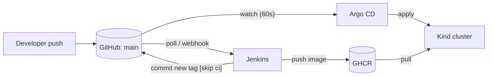

# GitOps delivery with Argo CD (Phase 3)



**The rule:** Jenkins never talks to the cluster. It builds, tests, scans, pushes an image, and edits one file in Git.
Argo CD, running inside the cluster, pulls that change and applies it. Prove it any time with `make verify-gitops`.

## App-of-apps layout

```
argocd/
  install/     Argo CD itself (pinned upstream manifest v3.3.6 + small patches + ingress)
  bootstrap/   root-app.yaml  <- the ONLY thing applied by hand
  apps/        everything root manages: AppProject + one Application per component
    project-orders.yaml   guardrails: allowed repo, namespace, cluster-scoped kinds
    orders-staging.yaml   -> k8s/overlays/staging   (auto-sync, prune, self-heal)
```

Later phases add files to `argocd/apps/` (monitoring, alerts, scanners). Root picks them up with no manual step.

## Run order

Jenkins must have produced images first, otherwise the pods cannot pull `:bootstrap` (they would sit in
`ImagePullBackOff` until the first Jenkins release commit lands; Argo CD then heals them on its own).

```bash
make cluster-up                 # Kind + Traefik (Phase 1)
make undeploy-dev               # only if you ran `make deploy` earlier: Argo CD must own the namespace
make jenkins-up                 # run one build so ghcr.io/adityasurve123/orders-* exist and are public
make argocd-up                  # install Argo CD (pinned)
make argocd-repo-creds          # ONLY if the GitHub repo is private
make argocd-bootstrap           # DB secret + root app; Argo CD takes it from here
make gitops-status              # orders-staging -> Synced / Healthy
make argocd-password            # login: http://argocd.localhost:8080, user admin
```

The DB password Secret is not in Git. `argocd-bootstrap` creates it out-of-band (random value); Phase 5 moves it to a
Sealed Secret so it can live in Git safely.

## Demonstrations (good screenshots)

| Demo | Command | Expected |
|---|---|---|
| Self-heal | `kubectl -n orders scale deploy/api --replicas=5` | Argo CD flips it back to the Git value within seconds |
| Drift on delete | `kubectl -n orders delete deploy/frontend` | Recreated automatically |
| Prune | delete a manifest from Git, push | The resource disappears from the cluster |
| Rollback | `git revert <release commit>` and push | Previous image tag is redeployed, with a full audit trail in `git log` |
| Pipeline-driven release | push a code change | Jenkins commits `chore(release): ... [skip ci]`; Argo CD rolls it out |

## Why these settings

- `selfHeal` + `prune`: Git is the single source of truth; the cluster cannot silently drift.
- `AppProject` instead of `default`: the app may only deploy from this repo into the `orders` namespace.
- `timeout.reconciliation: 60s`: faster feedback for a demo (default is 3 minutes). In production add a webhook.
- Annotation resource tracking: avoids label collisions with other tooling.
- `server.insecure`: TLS ends at the ingress; the UI is only exposed on localhost here.
